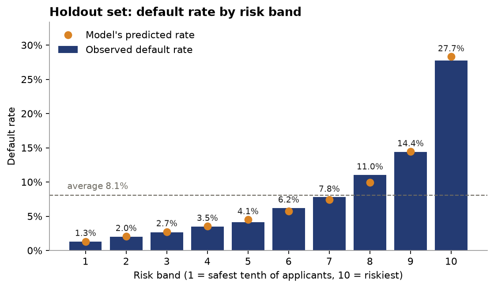
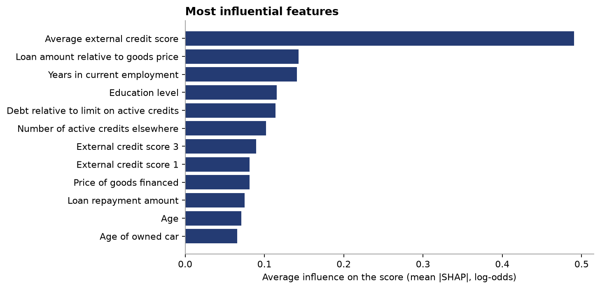
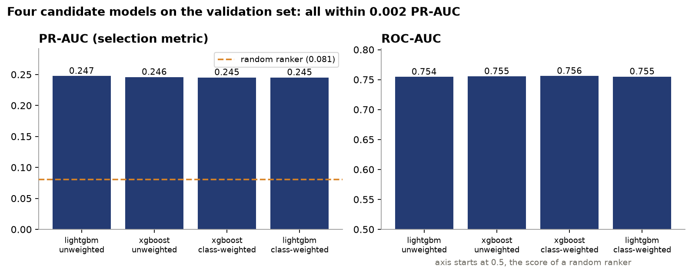
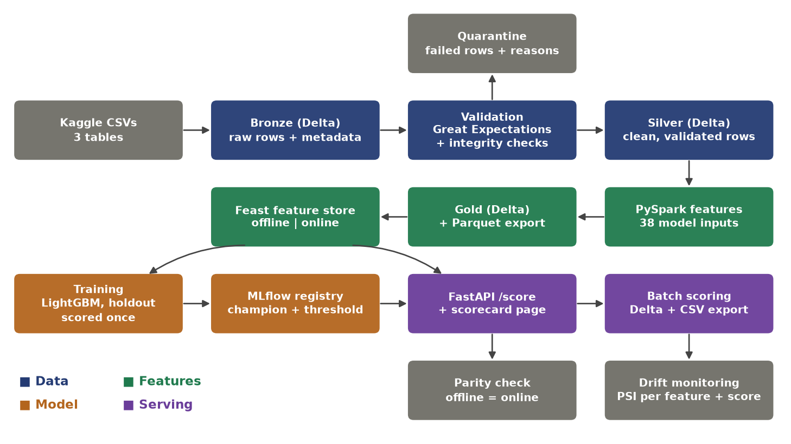
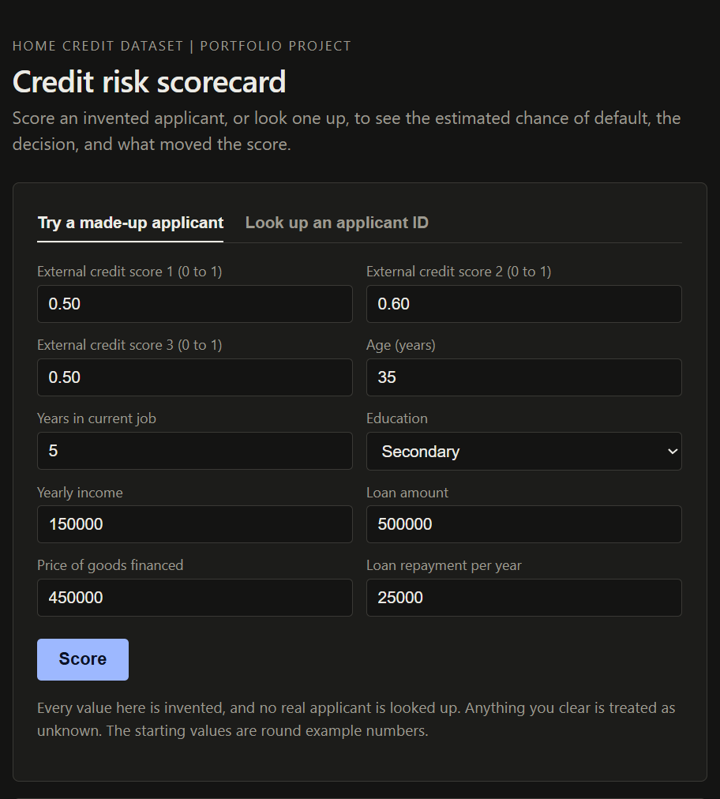
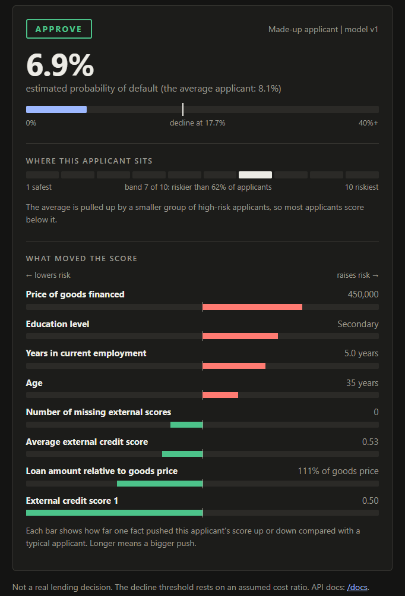

# Credit Risk Scoring Pipeline


An end-to-end, production-shaped ML pipeline for loan default risk on the public
**Home Credit Default Risk** data (307,511 applications plus 1.7M bureau and 1.7M
previous-application rows): raw files → validated data → feature store → tracked,
registered model → scoring API with plain-language reasons, plus batch
scoring and drift monitoring. See `ARCHITECTURE.md` for the original design notes.

## Results (real data, holdout set scored once)

| | PR-AUC | ROC-AUC | Brier | calibration error |
|---|---|---|---|---|
| validation | 0.245 | 0.753 | 0.0678 | 0.0034 |
| **holdout (15%, 46,127 applicants)** | **0.256** | **0.763** | 0.0673 | 0.0030 |

- A random ranker scores a PR-AUC equal to the default rate (0.081), so the model is about 3.2x better at ranking the rare class.
- Predicted probabilities match observed default rates (calibration error 0.003), so they can be used as probabilities without a calibration step.
- Illustrative decision rule: at threshold 0.177 the model approves 89.6% of applicants; the default rate among those approved is 5.8% (vs 8.1% overall), catching 35% of defaulters while declining 8% of good borrowers. The threshold comes from an **assumed** 5:1 cost ratio (approving a defaulter costs 5x declining a good borrower). It is a configurable assumption, not a measurement.
- 38 model inputs, LightGBM, no class weighting (weighting did not improve ranking). XGBoost and LightGBM, with and without weighting, were within 0.003 PR-AUC of each other, so the features, not the algorithm, limit performance.



*Bars show the default rate that actually occurred in each tenth of the holdout set, from safest to riskiest. The orange dots are the
model's predicted rates; they track the bars closely, which is what a calibration error of 0.003 looks like. All figures are aggregates.*





## Architecture



<details>
<summary>Text version</summary>

```
application_train.csv ─┐
bureau.csv ────────────┼─▶ Bronze (Delta) ─▶ Validation ─┬─▶ Silver (Delta, clean)
previous_application ──┘   raw + metadata    GE + checks  └─▶ Quarantine (CSV + reasons)

Silver ─▶ PySpark features ─▶ Gold (Delta) ─▶ Parquet export ─▶ Feast ┬─ offline ─▶ training
                                                                      └─ online  ─▶ API

training ─▶ MLflow (SQLite): runs, metrics, data hash, registry alias "champion"
API: POST /score  (Feast online features ─▶ champion model ─▶ probability + decision + reasons)
Batch: scored_applicants (Delta + CSV)      Monitoring: PSI drift report
```

</details>

## Demo page





*The demo page in "made-up applicant" mode, scoring invented example values.*

The scoring service also serves a small page at `/` with two modes:

- **Made-up applicant** (the default): type a few invented values (external credit scores, age, years in the job, income, loan amount, goods
  price, repayment, education). The model scores them and the page shows the estimated default probability, the approve or decline decision
  against the saved threshold, where that applicant would sit among all scored applicants (risk band 1 to 10), and a chart of the facts that pushed the
  score up or down. Values left blank are treated as unknown, and no real record is looked up.
- **Look up an applicant ID:** the same result for a record in the local feature store, which only works on a machine that has the data.

```
uvicorn src.serving.app:app --port 8000      # then open http://127.0.0.1:8000/
```

The page reads from the local feature store and model registry, so it is a local demo. It is not hosted, because the dataset
cannot be redistributed. The API behind it is documented at `/docs` (`POST /score` and `POST /score-custom`).

## Quickstart: Windows (PowerShell) vs bash

> **Windows vs bash.** Only a few things differ. The Python commands are identical.
>
> | | Windows PowerShell | bash (Linux / macOS / Git Bash) |
> |---|---|---|
> | activate the venv | `.venv\Scripts\Activate.ps1` | `source .venv/bin/activate` |
> | set `PYTHONPATH` | `$env:PYTHONPATH = $PWD.Path` | `export PYTHONPATH=$PWD` |
> | current UTC time for Feast | `(Get-Date).ToUniversalTime().ToString("yyyy-MM-ddTHH:mm:ss")` | `$(date -u +%Y-%m-%dT%H:%M:%S)` |
> | call the API | `Invoke-RestMethod -Uri http://127.0.0.1:8000/score -Method Post -ContentType "application/json" -Body '{"sk_id_curr": 100002}'` | `curl -X POST localhost:8000/score -H 'Content-Type: application/json' -d '{"sk_id_curr": 100002}'` |
> | scripts blocked? | `Set-ExecutionPolicy RemoteSigned -Scope CurrentUser` (once) | n/a |

**Requirements:** Python 3.11, Java 17 (PySpark needs a JVM), and the three Kaggle CSVs.
Accept the competition rules on Kaggle, download `application_train.csv`, `bureau.csv` and
`previous_application.csv`, and put them in `data/raw/`. The data is not included in this repo.

```powershell
uv venv --python 3.11            # or: python -m venv .venv
.venv\Scripts\Activate.ps1
uv pip install -r requirements.txt   # or: pip install -r requirements.txt
$env:PYTHONPATH = $PWD.Path
pytest tests -q                  # unit tests need no data

python -m src.ingestion.batch_loader        # CSVs -> Bronze (re-runnable, overwrites)
python -m src.validation.run_validation     # Bronze -> Silver + quarantine
python -m src.features.engineer_features    # Silver -> Gold + Feast parquet

cd feature_repo
feast apply
feast materialize-incremental (Get-Date).ToUniversalTime().ToString("yyyy-MM-ddTHH:mm:ss")
cd ..

python -m src.training.compare_models       # optional: 4-way model comparison
python -m src.training.train_champion       # train, track, score the holdout ONCE, register
python -m src.serving.parity_check --n 2000 # offline vs online features must match
python -m src.serving.batch_score           # export scores for every applicant (the demo page uses them for risk bands)
python -m src.monitoring.drift              # PSI drift report (add --simulate-shift to see an alarm)
python -m src.reporting.make_figures        # charts for this README -> docs/images/
uvicorn src.serving.app:app --port 8000     # demo page at http://127.0.0.1:8000/  (API docs at /docs)
```

Expect several minutes for the Spark and Feast steps on the full data. No Kaggle files? `python -m src.ingestion.generate_synthetic_data`
produces a narrower synthetic file for trying the first stages, but the Feast, training and serving stages assume the real tables.

## Design decisions

- **Medallion layers, nothing silently dropped.** Bronze keeps raw rows with ingestion metadata; rows that fail validation are
  quarantined to CSV with a `_failure_reasons` column. On the real data 4 of 307,511 applications failed validation (the `_failure_reasons` column in the quarantine CSV says why). 251k bureau and
  257k previous-application rows were quarantined as *orphans*: their applicant is not in the validated training table (consistent with being
  applicants from Kaggle's unlabeled test file).
- **Delta Lake via `deltalake` (delta-rs), not Spark's connector.** Same table format and ACID guarantees without Maven downloads. Only
  `src/common/config.py` changes for a Databricks move.
- **PySpark reads Silver through delta-rs's live file list** (`src/common/spark_delta_bridge.py`), converting delta-rs's percent-encoded
  paths so folders with spaces work on Windows.
- **Feast reads a plain Parquet export of Gold**, because its file store cannot read a Delta log. Gold stays the source of truth. The feature
  view has no TTL: all rows share one batch timestamp, and a finite TTL would silently return NULLs for later point-in-time joins.
- **Leakage control.** One stratified split (68% train / 17% validation / 15% holdout) saved to `data/splits/split_v1.parquet` and never
  regenerated. The holdout is evaluated once; later runs refuse to re-score it unless told to. Bureau and previous-application features use only history before the application
  (all `DAYS_*` values are relative to the application date). Training reads features through Feast's `get_historical_features`.
- **Missing is information.** Applicants with no bureau history get 0 for counts and NULL for everything else; tree models route NULLs natively.
  `ext_source_mean` is NULL (not 0) when all three scores are missing.
- **Sex is not a model input.** `is_male` stays in Gold for fairness auditing but is excluded from training. Age is used (see limitations).
- **Training/serving parity is tested, not assumed.** `parity_check` compares offline and online features for a sample of applicants,
  including which values are missing.
- **One real bug worth knowing.** LightGBM's default logloss metric stopped training after one tree when class weighting was on (weighted
  models are deliberately miscalibrated, so logloss looked "best" immediately). The fix monitors PR-AUC only; a regression test covers it.

## Project layout

```
src/common/        config.py (all paths/names), spark_delta_bridge.py
src/ingestion/     batch_loader.py, generate_synthetic_data.py, streaming_*.py (Kafka simulation)
src/validation/    ge_bronze_checks.py, run_validation.py, supplementary_checks.py
src/features/      engineer_features.py, application_passthrough.py, supplementary_features.py, spark_ops.py, feast_demo.py
feature_repo/      Feast definitions (entity, feature view, feature service credit_risk_features_v2)
src/training/      splits.py, data.py, compare_models.py, train_champion.py, evaluation.py, explain.py, model_card.py
src/serving/       app.py (FastAPI), scoring.py, registry.py, parity_check.py, batch_score.py
src/monitoring/    drift.py (PSI)
src/reporting/     make_figures.py (README charts from the report files)
docs/images/       README figures (aggregate charts only; committed)
tests/             unit tests; they build their own small data and never touch data/
reports/           (generated, gitignored) model_card.md, shap_summary.png, drift_report.csv, scored_applicants.csv
```

## Limitations and what I would do next

- **Random, not temporal, split.** The dataset has no application dates, so behaviour on a later period is unknown.
- **Selection bias.** Labels exist only for applicants who were approved; rejected applicants are never observed.
- **No fairness audit.** Age is a model input and no group-level error analysis was run.
- **Three tables unused.** `installments_payments`, `credit_card_balance` and `POS_CASH_balance` carry payment-behaviour signal that public
  solutions use to reach higher AUC; they were left out to keep the project explainable.
- **Local deployment only.** SQLite online store and MLflow backend, no cloud deploy, no scheduled retraining. Drift is checked on demand.
- **The cost ratio behind the threshold is assumed.**

## Data and licence note

This repository contains code only. The Home Credit data is not included: download it from Kaggle's Home Credit Default Risk
competition after accepting its rules, and use it as those rules allow. Trained models and applicant-level outputs (scored
applicants, per-applicant SHAP plots) are deliberately not published. All results and charts quoted here are
aggregate statistics.
